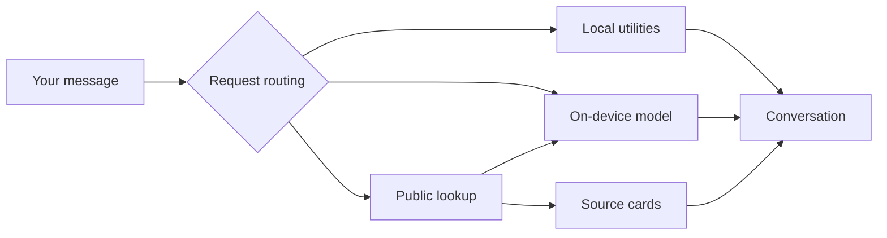

<div align="center">
  <a href="https://predatorray.github.io/CheapGPT/">
    
  </a>
  <h1>CheapGPT.</h1>
  <h3><em>Free of charge. Occasionally correct.</em></h3>
  <p>
    A ChatGPT-style chat app with a very modest brain.<br />
    Powered by your browser’s on-device model. No AI bill included.
  </p>
</div>

<p align="center">
  <a href="LICENSE"></a>
  <a href="https://github.com/predatorray/CheapGPT/actions/workflows/deploy.yml"></a>
  <a href="https://developer.chrome.com/docs/ai/prompt-api"></a>
  <a href="https://github.com/predatorray/CheapGPT"></a>
</p>

<p align="center">
  <a href="#features">Features</a> ·
  <a href="#quick-start">Quick start</a> ·
  <a href="#privacy">Privacy</a> ·
  <a href="docs/technical-guide.md">Technical guide</a>
</p>

---
<div align="center">
  <a href="https://predatorray.github.io/CheapGPT/" target="_blank" rel="noopener noreferrer"><h3>👉 Try CheapGPT ↗ 👈</h3></a>
</div>

<p align="center">
  <a href="https://predatorray.github.io/CheapGPT/" target="_blank" rel="noopener noreferrer">
    
  </a>
</p>

**Your device. Your conversations. Our very modest ambitions.**

CheapGPT pairs the browser’s `LanguageModel` (Prompt) API with a handful of useful tools. Draft an email, work through an idea, or ask for coding help locally. Let code handle the arithmetic and public services supply lookup results.

No remote AI API, API keys, application backend, accounts, or subscription. A small model can still make big mistakes—double-check the important stuff.

> [!IMPORTANT]
> Local AI needs an eligible browser and device, plus HTTPS or localhost. The first model download can be several gigabytes. Chrome’s built-in model is not available on mobile; the responsive interface and explicit tools remain available. See [browser support and setup](https://developer.chrome.com/docs/ai/prompt-api). Explicit tools remain usable when the model is unavailable.

## Features

|                              | A little capability, at no cost                                                                                                              |
| ---------------------------- | -------------------------------------------------------------------------------------------------------------------------------------------- |
| 🧠 **On-device chat**        | Stream answers from the browser’s local model, with Markdown, code blocks, and a Stop button.                                                |
| 🧮 **Useful tools**          | Local arithmetic and timezone checks, plus encyclopedia, repository, weather, place, IP, and exchange-rate lookups.                          |
| 🧭 **Auto tools**            | Explicit requests run directly; local AI can choose a lookup for other requests. Switch to **Just chat** to disable automatic tool requests. |
| 🗂️ **Browser-local history** | Search, switch, delete, copy, and export conversations. Turn persistence off on shared devices.                                              |
| 🔎 **Visible sources**       | Public lookup results include source cards. Place results offer an interactive OpenStreetMap view.                                           |
| 🌱 **Small-model harness**   | Validated plans, bounded context, retained source evidence, deadlines, and cancellation.                                                     |
| 📱 **Responsive interface**  | A quiet, warm palette across desktop and mobile layouts.                                                                                     |

## Give the tiny brain something to do

| Try asking…                                              | What happens                                                     |
| -------------------------------------------------------- | ---------------------------------------------------------------- |
| `Draft a polite follow-up email about an invoice`        | The local model helps with writing.                              |
| `Summarize these meeting notes: …`                       | Pasted text stays on-device for inference.                       |
| `What is 15% of 80?`                                     | The local calculator returns **12**.                             |
| `What is my timezone?`                                   | Reads the browser’s configured zone and current UTC offset.      |
| `Can you check the weather in Vancouver?`                | Looks up a three-day forecast through Open-Meteo.                |
| `Please search GitHub for React chat apps`               | Searches public repositories.                                    |
| `Convert 100 USD to CAD`                                 | Fetches daily reference rates and calculates the result in code. |
| `Summarize https://example.com/`                         | Reads page text if the site permits cross-origin access.         |
| `Could you rename this conversation to Weekly planning?` | Renames the chat locally and stops automatic title updates.      |

**Writing needs local AI. Explicit tools can work without it.** Calculator, clock, IP, and exchange-rate answers bypass model rewriting. For manual lookups, choose a tool from the composer menu.

## Quick start

Requires **Node.js 22.12+ (or 24+)** and npm.

```sh
git clone https://github.com/predatorray/CheapGPT.git
cd CheapGPT
npm ci
npm run dev
```

Open [localhost:5173](http://localhost:5173). No environment file or API key required.

Send a chat message to start the local model when available. Download progress appears in the conversation; **Stop** cancels setup or generation. Calculator and clock requests do not trigger a model download.

## Privacy

| Mode or feature              | What leaves your device?                                                                                          |
| ---------------------------- | ----------------------------------------------------------------------------------------------------------------- |
| **Just chat**                | No prompt or conversation is sent to an AI server. Inference is local.                                            |
| **Calculator / Date & time** | Nothing. Arithmetic, browser timezone, and clock checks run locally.                                              |
| **Public lookup tools**      | The lookup query goes to the chosen provider, which also sees your IP. The full conversation is not sent.         |
| **Read website**             | A direct request goes to the supplied URL. No remote scripts, images, or frames are loaded from the fetched page. |
| **Model installation**       | The browser manages a separate download, which requires network access.                                           |
| **Saved conversations**      | Up to 50 chats stay in this browser’s unencrypted `localStorage`. No account or server storage.                   |

There are no analytics, tracking scripts, or remotely loaded fonts in the app. OpenStreetMap embeds make a separate request to display the map. **Remember conversations** controls persistence; **Delete all chats** clears saved history.

## A few honest limitations

- **Small model, modest reasoning.** English is the explicitly supported model language. Generated answers and tool choices can be wrong.
- **Browser support varies.** OS, hardware, storage, region, and browser configuration affect local AI availability. Unsupported browsers show guidance.
- **Website reading depends on CORS.** Many sites block direct browser reads. Authenticated pages, JavaScript-rendered content, PDFs, and other downloads are unsupported. There is no proxy to bypass restrictions.
- **Public APIs have limits.** Provider outages, quotas, and CORS restrictions can interrupt lookups. Exchange rates are daily reference rates; IP geolocation is approximate.
- **Context is bounded.** Recent successful rounds and source excerpts go to the model. Older messages stay in your history but may be outside the current model context.

[Tool providers, quotas, and attribution →](docs/technical-guide.md#a-few-free-tools)

## Under the hood

**React 19 · TypeScript · MUI 7 · Vite · Prompt API · Vitest · Playwright**



Explicit requests take precedence over model guesses. Other requests can use one validated JSON lookup plan. Each reply gets its own cloned model session, with bounded context and cancellation.

[Read about the small-model harness →](docs/technical-guide.md#a-harness-for-a-small-model)

## Development

```sh
npm test                  # Unit tests
npm run build             # Type-check + production build → dist/
npm run preview           # Preview the production build
npx playwright install chromium
npm run test:integration  # Browser integration tests
```

Browser tests use provider fixtures and a mocked or disabled native model. They verify app behavior and API contracts; they do not download Nano or establish live inference quality.

The [GitHub Actions workflow](.github/workflows/deploy.yml) tests and builds pull requests, then deploys successful pushes to `main` to GitHub Pages. Relative assets support repository subpaths.

[Deployment and custom-domain setup →](docs/technical-guide.md#github-pages)

## License

[MIT](LICENSE) © 2026 [Wenhao Ji](https://github.com/predatorray).

<p align="center">
  <sub>An independent parody project. Not affiliated with OpenAI or ChatGPT.</sub><br />
  <sub>Free of charge. Occasionally correct.</sub>
</p>
